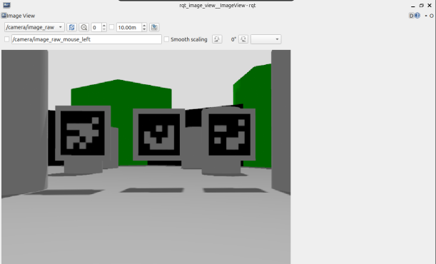
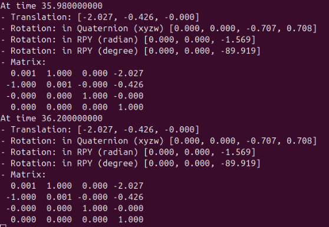
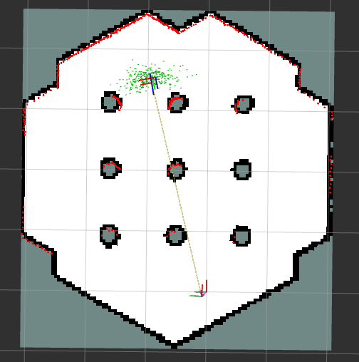
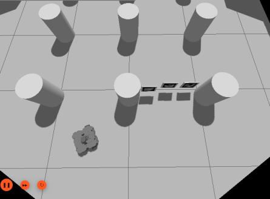
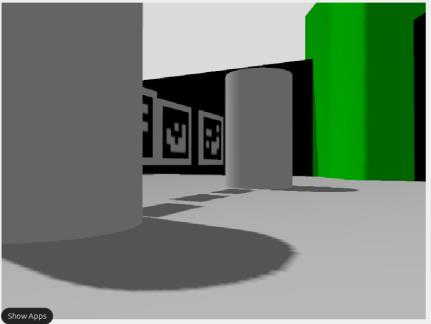
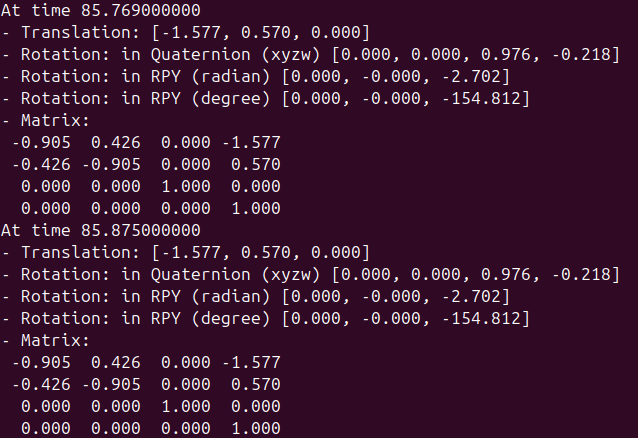
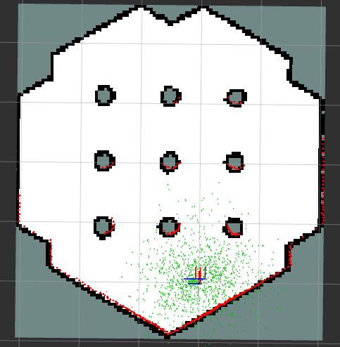
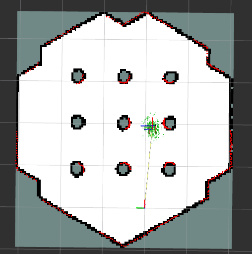
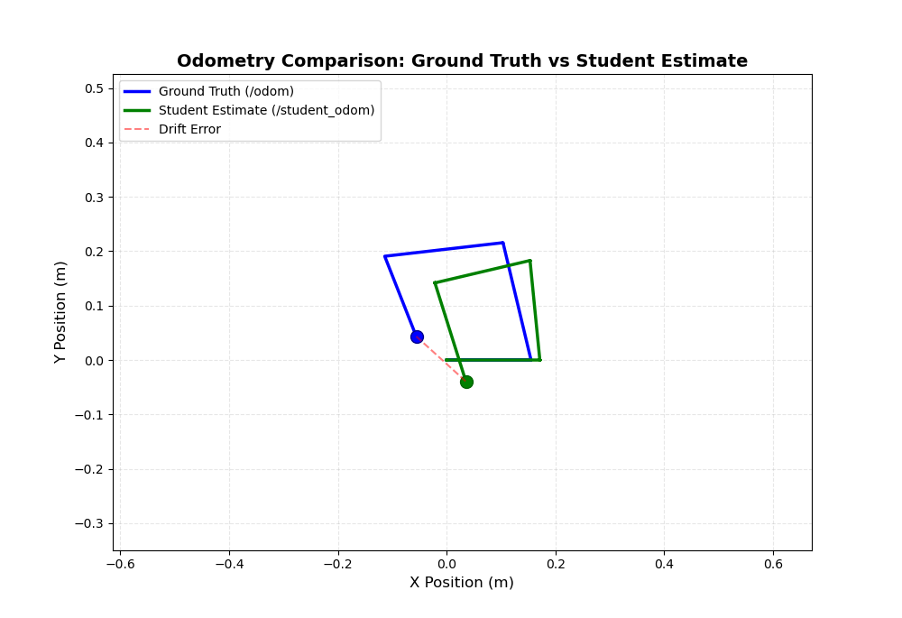

# TurtleBot3 Localization & Navigation (ROS 2)

Camera-based landmark localization, a custom potential-field navigator and an odometry drift
study on a simulated TurtleBot3, built with **ROS 2 Jazzy**, **Gazebo** and **Nav2**.

<p align="center">
  
  
  
</p>

## Highlights

- **AMCL replaced by three ArUco markers.** A node of about 300 lines turns marker detections
  into the robot's global pose and publishes the standard `map → odom` transform. Any Nav2 stack
  can use it in place of AMCL. Unlike AMCL, it needs no particle filter, does not drift and
  re-localizes as soon as a marker comes into view.
- **Nav2's planner replaced by an Artificial Potential Field controller.** The robot is
  attracted to the goal and repelled by LiDAR returns. It detects local minima and escapes them,
  and after tuning it passes between closely spaced pillars.
- **Dead-reckoning drift made visible.** Wheel odometry is integrated from `/joint_states` and
  plotted live against ground truth, with final, mean and RMS error.

| Package | What it does |
|---|---|
| [`aruco_localization`](src/aruco_localization) | Global pose from ArUco markers with known map poses, broadcast as `map → odom` |
| [`apf_nav`](src/apf_nav) | One-command bring-up: Gazebo, map server, AMCL, RViz and the APF controller |
| [`tb3_odometry`](src/tb3_odometry) | Open-loop square driving, wheel odometry and live drift plot |

---

## 1. Landmark localization with ArUco markers vs. AMCL

**Setup.** A TurtleBot3 Waffle Pi (it carries a camera) runs in the TurtleBot3 world, mapped
beforehand with SLAM. Three 16 cm ArUco markers are placed at camera height at known poses
([`marker_map_poses.yaml`](src/aruco_localization/config/marker_map_poses.yaml)).
[`ros2_aruco`](https://github.com/JMU-ROBOTICS-VIVA/ros2_aruco) detects the markers.

**Method.** Each visible marker *i* gives one estimate of the robot pose:

$$
T^{map}_{base,i} = T^{map}_{marker,i}\,\big(T^{base}_{camera}\,T^{camera}_{marker,i}\big)^{-1}
$$

The estimates are averaged, using a circular mean for yaw. The node then publishes
$T^{map}_{odom} = T^{map}_{base}\,(T^{odom}_{base})^{-1}$, the same TF contract that AMCL fulfils.

**Results.** The estimated pose, about (−2.03, −0.43) m with yaw −90°, matches the spawn pose.
Driving forward changes only *x*, as expected. Rotated and oblique poses are recovered
correctly. The estimate is noticeably **more stable with two or more markers in view**.

| Oblique view (Gazebo) | Robot camera | Estimated pose |
|---|---|---|
|  |  |  |

| Criterion | AMCL | ArUco landmarks |
|---|---|---|
| Computational load | High (particle filter) | Low (closed form per marker) |
| Requires | Occupancy map | Markers at known poses |
| Sensors | LiDAR + odometry | Monocular camera |
| Lighting dependence | None | Strong |
| Fails in | Feature-poor or symmetric spaces (corridors) | Occlusion, poor lighting, no marker in view |
| Drift | Bounded but present; the particle cloud spreads when the robot is stationary | None while a marker is visible |

→ Full write-up: [docs/aruco_localization.md](docs/aruco_localization.md)

## 2. Artificial Potential Field navigation

**Method.** AMCL provides the pose and the goal comes from RViz. The goal attracts the robot
with $F_{att} = k_{att}\,\mathbf{g}$. Each laser return closer than $d_0$ repels it with
$F_{rep} = k_{rep}\,(1/d - 1/d_0)/d^2$, weighted towards the front of the robot. The direction of
the net force sets the turn rate and its magnitude sets the speed. If the robot stops making
progress towards the goal (a local minimum), it performs an escape turn. Once at the goal
position, it rotates to the requested heading.

**Results.** Goals in open space are reached reliably. With the initial gains, the overlapping
repulsive fields of neighbouring pillars blocked narrow passages. After tuning `k_rep`, the
influence distance and the escape behaviour, the robot passes between them. APF is cheap to run
but sensitive to its gains: poor tuning gives jagged paths and frequent local minima, while
Nav2 produces smooth paths that keep clearance from obstacles.

| AMCL initialisation | Passage between pillars | Long goal |
|---|---|---|
|  |  |  |

→ Full write-up: [docs/apf_navigation.md](docs/apf_navigation.md)

## 3. Wheel odometry and drift

**Method.** The robot drives a nominal square with **open-loop** timed commands. Wheel speeds
from `/joint_states` are integrated with the differential-drive model
($v = \tfrac{v_r + v_l}{2}$, $\omega = \tfrac{v_r - v_l}{L}$), and the result is plotted against
Gazebo ground truth.

<p align="center"></p>

**Results.** The true path (blue) is not a square and changes from run to run, because open-loop
commands cannot correct for wheel slip or timing. The estimate (green) drifts away from ground
truth because the model ignores slip and amplifies any calibration error. These errors
**accumulate**: a small heading error becomes a large lateral offset on a long straight segment.
This drift is what the absolute localization in sections 1 and 2 corrects.

→ Full write-up: [docs/odometry.md](docs/odometry.md)

---

## Quick start

Requires Ubuntu 24.04 with ROS 2 Jazzy, Gazebo Harmonic and the TurtleBot3 simulation packages.

```bash
sudo apt install ros-jazzy-turtlebot3* ros-jazzy-nav2-bringup python3-matplotlib
pip3 install opencv-contrib-python transforms3d   # required by ros2_aruco
mkdir -p ~/tb3_ws/src && cd ~/tb3_ws/src
git clone https://github.com/AghyadA1/turtlebot3-localization-navigation.git
vcs import . < turtlebot3-localization-navigation/dependencies.repos
cd ~/tb3_ws && rosdep install --from-paths src -i -y && colcon build --symlink-install
source install/setup.bash
```

**ArUco localization**
```bash
export TURTLEBOT3_MODEL=waffle_pi
export GZ_SIM_RESOURCE_PATH=$GZ_SIM_RESOURCE_PATH:$(ros2 pkg prefix aruco_localization)/share/aruco_localization/models
ros2 launch turtlebot3_gazebo turtlebot3_world.launch.py
ros2 launch aruco_localization spawn_markers.launch.py
ros2 launch aruco_localization localization.launch.py
```

**APF navigation** (in RViz, set a *2D Pose Estimate*, then a *2D Goal Pose*)
```bash
export TURTLEBOT3_MODEL=burger
ros2 launch apf_nav apf_nav.launch.py
```

**Odometry drift**
```bash
export TURTLEBOT3_MODEL=burger
ros2 launch turtlebot3_gazebo empty_world.launch.py
ros2 launch tb3_odometry odometry_experiment.launch.py save_path:=$PWD/odometry.png
ros2 run tb3_odometry square_movement
```

## Repository layout

```
src/
├── aruco_localization/  # marker_localizer node, Gazebo marker models, map, launch files
├── apf_nav/             # apf_controller node, AMCL config, map, one-command launch
└── tb3_odometry/        # square_movement, wheel_odometry, odom_plotter
docs/                    # per-experiment write-ups and figures
dependencies.repos       # third-party sources (ros2_aruco)
```

## Limitations and next steps

- The results are qualitative: screenshots from individual runs. The next step is a quantitative
  benchmark of pose RMSE for odometry, AMCL and ArUco over the same trajectories, and of success
  rate and time-to-goal for APF vs. Nav2.
- Marker fusion is a plain average. Weighting by distance and viewing angle, or fusing with
  odometry in an EKF (`robot_localization`), would reduce jitter between sightings.
- APF could serve as the local planner under a global planner, which would avoid local minima
  systematically.

## Acknowledgements and license

Marker detection by [ros2_aruco](https://github.com/JMU-ROBOTICS-VIVA/ros2_aruco) (MIT).
Simulation assets from [TurtleBot3](https://github.com/ROBOTIS-GIT/turtlebot3_simulations).
Released under the [Apache License 2.0](LICENSE) © Aghyad Ali.
