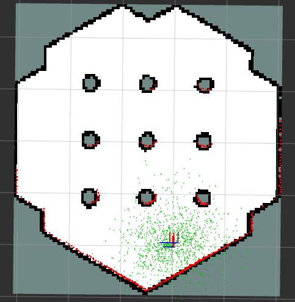
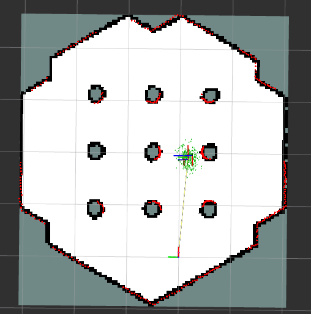
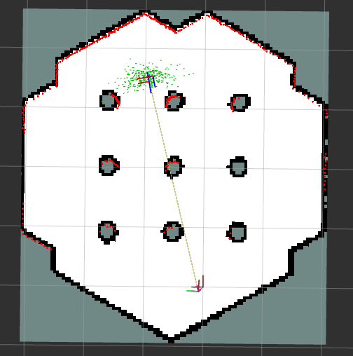
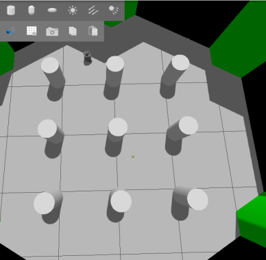

# Experiment 3: Artificial Potential Field navigation on top of AMCL

## Architecture
`apf_nav.launch.py` starts, in one command: TurtleBot3 world (Gazebo), `map_server` with the SLAM
map, `amcl`, a lifecycle manager, RViz, and `apf_controller`, which takes the place of the Nav2
planner and controller.

| Input | Topic |
|---|---|
| Robot pose | `/amcl_pose` |
| Goal | `/goal_pose` (RViz *2D Goal Pose*) |
| Obstacles | `/scan` |
| Output | `/cmd_vel` (`TwistStamped`), executed path on `/apf_path` |

## Control law (10 Hz)
1. **Attraction:** `F_att = k_att · g`, where `g` is the goal vector expressed in the robot frame.
2. **Repulsion:** for each laser return within the frontal window (`front_angle_window_deg`) and
   closer than `d0 = repulsive_distance`, with clearance `d = r − robot_radius`:
   `|F_rep| = k_rep · (1/d − 1/d0) / d²`, directed away from the obstacle. The force is weighted
   by `cos²(bearing)` so that side walls push less than obstacles ahead, and its lateral component
   is scaled by 0.35 to damp oscillation in corridors.
3. **Command:** `ω = sat(k_ω · atan2(F_y, F_x))`, `v = sat(k_v · |F| · max(0, cos(heading)))`.
   `v` is further reduced when the heading error is large.
4. **Safety and recovery:** if three or more returns within ±20° are closer than
   `emergency_stop_distance`, forward motion stops and the robot turns in place. If the distance to the goal has not improved by
   `progress_epsilon` within `progress_timeout`, or the net force vanishes, the controller
   assumes a **local minimum** and performs a timed in-place escape turn.
5. **Final alignment:** inside the position tolerance the robot rotates in place to the goal
   yaw; the goal counts as reached when both position and yaw errors are within tolerance.

Laser bearings are wrapped to [−π, π] before windowing, because the TurtleBot3 LDS reports
angles in [0, 2π).

Tuned values are in `launch/apf_nav.launch.py` (e.g. `k_att = 1.2`, `k_rep = 0.25`,
`d0 = 0.75 m`, `robot_radius = 0.12 m`, window 140°).

## Results

| AMCL initialisation | Passage between pillars | Long goal | Gazebo |
|---|---|---|---|
|  |  |  |  |

- Goals in open space, far from walls, were reached reliably from the start.
- Goals that required passing **between the cylindrical pillars** initially failed, because the
  robot would not enter the gap. Two overlapping repulsive fields create a barrier, or a local
  minimum, in front of a passage that is geometrically wide enough.
- After tuning, the robot balances safety and reachability and passes between obstacles.

## Discussion
APF is computationally trivial and needs no global plan, but it has **many interacting gains**.
With poor tuning the path is jagged, unlike the smooth Nav2 path, and most non-trivial goals are
unreachable because of local minima. The escape turn is a heuristic, not a guarantee. A principled
improvement is to use APF only as a local planner that follows waypoints from a global planner
(A*/Nav2 Smac), or to use navigation functions or harmonic potentials, which have no spurious
minima.
