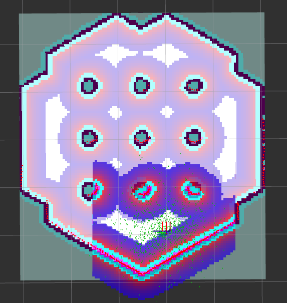
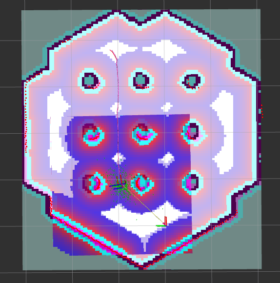
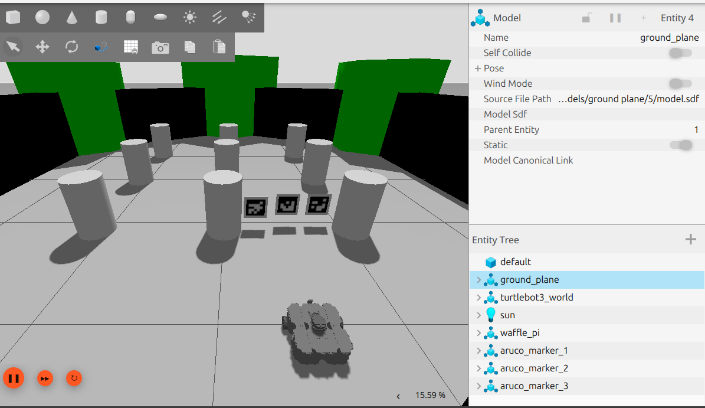
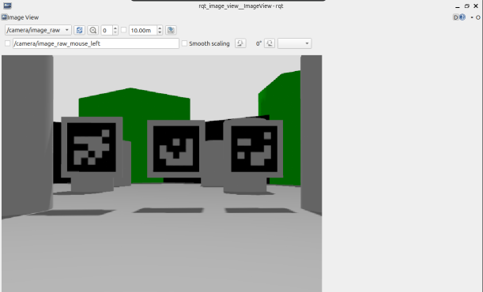
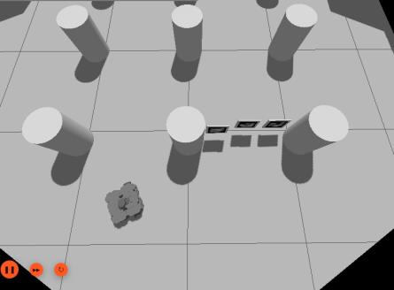
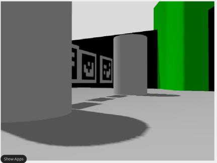
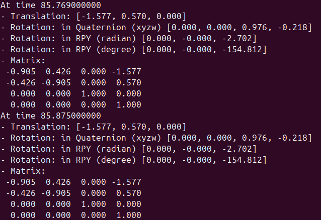

# Experiment 2: Landmark localization with ArUco markers, compared with AMCL

## AMCL baseline
After a *2D Pose Estimate* is given in RViz, AMCL initialises a widely spread particle cloud.
As the robot moves, new laser scans are weighted against the map and the cloud contracts around
the true pose. The Nav2 path (pink) is smooth and keeps clearance from walls. When the robot stops,
the cloud slowly spreads again, because the motion model keeps injecting uncertainty while no new
information arrives.

| Initial particle cloud | After motion |
|---|---|
|  |  |

## Marker setup
- Robot: TurtleBot3 **Waffle Pi** (RGB camera, frame `camera_rgb_frame`).
- Map: the TurtleBot3 world, mapped beforehand with SLAM (`config/my_map.*`).
- Markers: three Gazebo models (`models/aruco_marker_{1,2,3}`), each a white 20 × 20 cm board
  carrying a 16 cm `DICT_5X5_250` marker texture, placed at camera height (z = 0.2 m) to limit
  perspective distortion. The marker IDs (1, 84, 90) and their world poses (x, y, yaw) are stored
  in `config/marker_map_poses.yaml`. The board's roll (π/2, i.e. upright) and height are node
  parameters.
- `spawn_markers.launch.py` inserts the boards through the `gz service /world/default/create` API.
- `localization.launch.py` starts `ros2_aruco`, `marker_localizer`, the map server, a static
  `map → world` transform (Gazebo world origin is the centre of the central pillar ring; floor
  tiles are 1 m) and RViz.

| Gazebo scene | Robot camera |
|---|---|
|  |  |

## Algorithm
For each detection of a known marker:

```
T_base_marker = T_base_camera · T_camera_marker        # TF lookup + ros2_aruco pose
T_map_base_i  = T_map_marker_i · inv(T_base_marker)    # one pose hypothesis per marker
```

The planar components of all hypotheses are fused (mean of x and y, circular mean of yaw) and the
odometry-frame correction `T_map_odom = T_map_base · inv(T_odom_base)` is broadcast. Downstream
consumers therefore keep the usual `map → odom → base` chain, and the odometry stays continuous
while the global estimate jumps to the marker-derived pose.

## Results
- **Initial pose.** `world → base_link` ≈ (−2.03, −0.43, 0) m, yaw −89.9°, consistent with the
  spawn pose.
- **Straight motion.** After driving forward only *x* changed (−2.03 → −1.51 m). Both *y* and
  the yaw stayed constant.
- **Arbitrary poses.** Rotated and oblique poses (yaw −129°, −155°, −125°) were recovered
  consistently with the Gazebo pose, both with two markers clearly visible and with only one.

| Oblique view (Gazebo) | Camera | Estimate |
|---|---|---|
|  |  |  |

Across trials the estimate was **more stable with several markers in view**, since averaging
independent hypotheses reduces the effect of per-marker pose noise.

## Comparison

| Criterion | AMCL | ArUco landmarks |
|---|---|---|
| Computational load | High | Low |
| Environment requirement | Map | Physical markers at surveyed poses |
| Sensors | LiDAR, odometry | Camera |
| Lighting dependence | Not affected | Strongly affected |
| Weak scenarios | Feature-poor or symmetric environments (e.g. corridors) | Poor marker visibility: bad lighting, occlusion, markers out of view |
| Drift | Present; accuracy degrades while the robot is stationary | None while a marker is visible; immediate correction on sighting |

The two methods are complementary. AMCL provides continuous coverage, and markers provide
drift-free, immediate fixes where they are installed.
