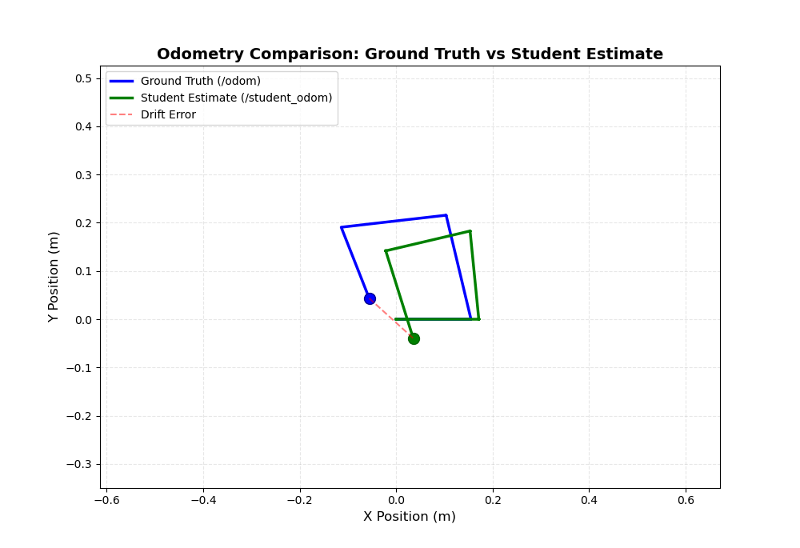

# Experiment 1: Open-loop motion and wheel-odometry drift

## Setup
- TurtleBot3 Burger in an empty Gazebo world.
- `square_movement` publishes `TwistStamped` on `/cmd_vel`: 0.2 m/s for 3 s, stop, 1.0 rad/s for
  5 s, stop, repeated four times. There is no feedback of any kind.
- `wheel_odometry` reads wheel angular velocities from `/joint_states`, converts them to wheel
  linear velocities (`v = ω · r`, r = 0.033 m) and integrates the differential-drive model with
  L = 0.160 m at 10 Hz. Output: `/wheel_odom`.
- `odom_plotter` plots `/odom` (simulator, treated as ground truth) against `/wheel_odom`.

## Result

## Discussion
**Ground truth vs. intent.** The trajectory reported by Gazebo (blue) is not a square, and
repeated runs give different shapes even though the command sequence is identical. Even inside a
single run, the four sides and the four turns differ in length and angle. This is the expected
behaviour of an **open-loop** controller: commanded velocities do not translate exactly into
motion, and nothing corrects the deviation.

**Estimate vs. ground truth.** The odometry estimate (green) departs from ground truth because
the simulator models effects that the simple forward-kinematic model cannot capture:

1. **Wheel slip.** Slip grows with the applied acceleration. Under full slip the joint states
   stay constant while the robot's actual position changes, and the reverse also happens.
2. **Model (calibration) error.** Any small error in the wheel radius or wheel separation
   produces an error at every integration step, and that error accumulates with distance.
3. **Discretisation.** Euler integration at a fixed rate is itself an approximation.

**Accumulation.** Each error is small per step, but dead reckoning integrates them, so the error
grows without bound in time and distance. A heading error is the most damaging. A small
difference between the estimated and true heading, caused for example by gear backlash or encoder
quantisation on a real robot, becomes a large lateral position error after a long straight
segment. The figure shows how small discrepancies at the start of the path grow into a large
offset at the end.

This motivates the absolute (map-referenced) localization methods studied in experiments 2 and 3.
